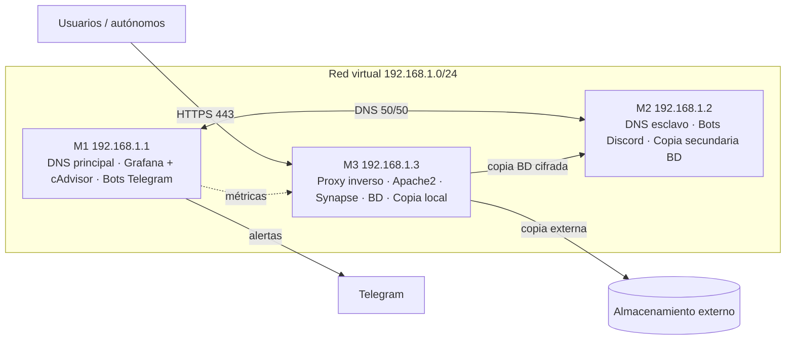
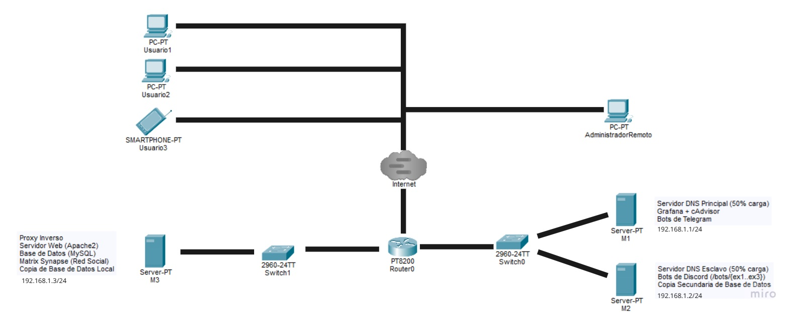

# TFG ISA | Infraestructura cloud, despliegue y automatización de red social para autónomos

**Ciclo:** Administración de Sistemas Informáticos en Red (ASIR/ISA)
**Módulo:** Proyecto de Administración de Sistemas Informáticos en Red
**Autor/es:** Andrés Ruslan Abadías Otal (@nisamov) y Vladyslav Ostroushko(@vuladisulavu-dot)
**Tutor/a:**
**Centro:** IES Sierra de Guara
**Fecha:** 16/10/2026

> Formato de entrega: PDF con portada institucional, índice paginado y tipografía formal. Este `.md` es la base; los textos entre corchetes `[ ]` son datos que debes completar o verificar.

---

## Índice

1. Definición de la idea de proyecto y justificación
   1.1 Justificación y contexto · 1.2 Objetivos · 1.3 Alcance y delimitación
2. Análisis del sector productivo y entorno empresarial
   2.1 Caracterización de la entidad cliente · 2.2 Oportunidades de negocio y viabilidad · 2.3 Marco legal y normativa · 2.4 Financiación y subvenciones
3. Estudio de viabilidad técnica y arquitectura del sistema
   3.1 Recopilación de información · 3.2 Viabilidad técnica · 3.3 Especificación de la arquitectura
4. Estimación de recursos y presupuesto económico inicial
   4.1 Recurso material y licenciamiento · 4.2 Recursos humanos · 4.3 Presupuesto de ejecución · 4.4 Necesidades de financiación
5. Guion de trabajo y calidad del diseño
   5.1 Guion metodológico · 5.2 Indicadores de calidad
6. Fuentes consultadas

---

# 1. Definición de la idea de proyecto y justificación

## 1.1. Justificación y contexto

**Necesidad.** Los autónomos (unos 100.000 en Aragón **[citar fuente y fecha: INE / Seguridad Social / ATA]**) trabajan de forma aislada. No disponen de un canal propio y profesional para contactar entre ellos, captar clientes o acceder a proveedores. Hoy dependen de redes generalistas, sin control de los datos, o de intermediarios que cobran comisión.

**Carencia tecnológica exacta.** No existe una plataforma de comunicación profesional que a la vez:

1. permita crear comunidades y agrupaciones por sector o territorio;
2. permita que grandes almacenes y proveedores de suministros ofrezcan sus servicios directamente, lo que genera competencia y mejora la accesibilidad;
3. mantenga los datos cifrados y bajo control del operador (RGPD);
4. escale con rapidez ante picos de demanda y mantenga alta disponibilidad en servicios clave (DNS y base de datos) con un coste mínimo.

**Propuesta.** Una red social basada en **Matrix Synapse**, desplegada en la nube sobre tres nodos (M1, M2, M3) con redundancia de DNS y de copias de seguridad, observabilidad en tiempo real y protección perimetral de la aplicación. Al ser una infraestructura 100 % cloud, **no requiere hardware físico**: el coste se reparte entre software, servicios cloud y mano de obra.

## 1.2. Objetivos del proyecto

### Objetivo general

Diseñar, desplegar, automatizar, monitorizar y endurecer la infraestructura cloud que soporte una red social profesional para autónomos, ofreciendo accesibilidad y competencia entre entidades del mismo y de distinto sector y una comunicación rápida entre clientes y trabajadores.

### Objetivos específicos (medibles)

| Nº | Objetivo | Indicador medible |
| :-- | :--- | :--- |
| OE1 | Despliegue rápido ante picos de demanda | Nueva instancia de servicio operativa en ≤ [X] min mediante scripts/plantillas |
| OE2 | Datos y conexiones cifradas | 100 % del tráfico externo por TLS; solo los puertos esenciales abiertos; permisos mínimos en la administración de contenedores |
| OE3 | Automatización de contenedores | Despliegue, reinicio, actualización y copias sin intervención humana |
| OE4 | Configuración dinámica | Migrar o desplegar un nodo nuevo cambiando solo variables/ficheros de configuración |
| OE5 | Cortos tiempos de respuesta | Respuesta entre 75 ms y 125 ms medida contra **M3** (nodo que sirve web y Matrix) |
| OE6 | Redundancia DNS | Reparto 50/50 entre M1 y M2 con respuesta correcta si cae uno de los dos |
| OE7 | Copias de seguridad | Copia cifrada diaria de la BD, réplica en otro nodo, copia externa y purga automática a los 30 días |
| OE8 | Monitorización | 100 % de los nodos y contenedores visibles en Grafana, con alerta por Telegram |
| OE9 | Disponibilidad | ≥ 99,5 % mensual del servicio Matrix (ver 5.2) |

## 1.3. Alcance y delimitación

**Incluye (se va a instalar):**

- Matrix Synapse sobre Apache2 y proxy inverso (nodo M3).
- Base de datos principal con copia local y copia secundaria en M2.
- DNS principal (M1) y esclavo (M2) con balanceo 50/50; DHCP principal y esclavo **[confirmar ubicación, ver 3.3]**.
- Monitorización con Grafana + cAdvisor y bots de Telegram (M1); bots de Discord `/bots/{ex1..ex3}` (M2).
- Hardening de los tres nodos y automatización de copias y rotación.

**Servicios accesibles por el usuario:** Servicio Web y Servicio Matrix (red social).
**Servicios no accesibles (internos):** Proxy, DNS y DHCP.

**Queda fuera:**

- Desarrollo de aplicaciones cliente propias (se usan clientes Matrix existentes).
- Hardware físico, cableado y electrónica de red de los usuarios.
- Moderación de contenidos, gestión comercial y captación de usuarios.
- Soporte técnico de nivel 1 a los usuarios finales.
- [COMPLETAR: otras exclusiones]

---

# 2. Análisis del sector productivo y entorno empresarial

## 2.1. Caracterización de la entidad cliente

Como el proyecto da servicio a **múltiples empresas**, la ficha distingue entre la **entidad operadora** (quien gestiona la plataforma) y el **colectivo cliente** (autónomos y proveedores).

### Ficha de identificación básica

| Campo | Entidad operadora | Colectivo cliente |
| :--- | :--- | :--- |
| Nombre / razón social | [COMPLETAR – real o ficticia] | Autónomos y proveedores de suministros |
| Sector de actividad | Servicios TIC / plataforma de comunicación profesional | Multisectorial (comercio, hostelería, construcción, servicios profesionales, transporte…) |
| Tamaño y tipo | Microempresa (< 10 empleados) | Autónomos (microempresas) y grandes almacenes/proveedores como oferentes |
| Ubicación geográfica | [COMPLETAR – sede principal]; infraestructura en región cloud de la UE | Aragón al inicio, con expansión prevista |
| Sedes secundarias / movilidad | No hay sedes físicas de infraestructura | Alta movilidad: acceso desde móvil, tablet y portátil |

### Organigrama y perfil de los usuarios

- **Dirección / gerencia de la operadora:** pocos usuarios. Necesitan acceso remoto seguro, paneles de métricas y alertas.
- **Administración de sistemas:** perfil técnico que opera los nodos, los contenedores, las copias y la monitorización.
- **Autónomos (usuarios finales):** acceso externo y móvil, con niveles digitales muy distintos. Necesitan una plataforma sencilla, siempre disponible y que proteja sus datos personales y comerciales (RGPD).
- **Grandes almacenes / proveedores (postores):** publican ofertas y promociones a muchos usuarios. Necesitan escalabilidad y disponibilidad.
- **Administradores de comunidades:** crean y moderan agrupaciones por sector o zona.

### Mapa funcional del negocio (¿cómo circula la información?)

> "El autónomo se registra en la plataforma y se une a comunidades de su sector → publica una necesidad u oferta o contacta con otros profesionales → el proveedor recibe la solicitud y responde con una propuesta o promoción → ambas partes cierran el trato y el sistema conserva el historial cifrado, con copias de seguridad automáticas y monitorización continua."

### Traducción de la estructura en necesidades técnicas

| Perfil / departamento | Herramienta / software usado | Necesidad informática real |
| :--- | :--- | :--- |
| Dirección / gerencia operadora | Grafana, Telegram, SSH | Acceso remoto seguro (SSH con clave, sin contraseña), paneles de métricas y alertas en el móvil |
| Administración de sistemas | Docker, scripts de despliegue, cron | Automatización de contenedores, configuración por variables, copias cifradas diarias y purga a 30 días |
| Autónomos (usuarios finales) | Cliente Matrix en móvil o web | Disponibilidad, respuesta de 75–125 ms, TLS y recuperación del historial si hay fallo |
| Grandes almacenes / proveedores | Cliente Matrix, salas y comunidades | Escalabilidad ante picos de mensajes y despliegue rápido de recursos adicionales |
| Administradores de comunidades | Salas y espacios de Matrix | Gestión de permisos y roles por sala |
| Transversal (protección de datos) | Cortafuegos de la nube, cifrado | Cifrado en tránsito y en copias, mínimo privilegio, secretos aislados y cumplimiento del RGPD |

## 2.2. Oportunidades de negocio y viabilidad

**Demanda en el mercado.** El colectivo potencial son los autónomos aragoneses **[dato + fuente]**. La oportunidad es doble: un canal propio de captación para ellos y un canal de venta para los proveedores de suministros.

**1. Retorno por evitación de pérdidas (ROI por riesgo).** La plataforma es el canal de contacto comercial de sus usuarios, así que una parada afecta a todos a la vez. Coste de una parada = (usuarios activos × horas de negocio dependiente × valor/hora) + coste reputacional. Con la infraestructura en nube, una caída se resuelve restaurando desde copia en ≤ 2 h (RTO, ver 5.2) en vez de reconstruir un servidor. **[Completar con una cifra propia validada, p. ej. mediante encuesta a autónomos.]**

**2. Eliminación de la obsolescencia (deuda técnica).** Se usan componentes con soporte vigente (Ubuntu LTS, Synapse mantenido, contenedores actualizables). Al ser cloud no hay hardware que amortizar ni caducar. Además se evita el bloqueo con un único proveedor: el despliegue es portable entre Oracle, Hetzner o AWS, y esto es relevante porque Oracle redujo en junio de 2026 su capa gratuita (ver 3.1).

**3. Eficiencia y productividad.** Un autónomo que recibe peticiones de presupuesto de proveedores en una sola plataforma ahorra horas de búsqueda y llamadas. Cálculo: horas ahorradas/mes × tarifa/hora × nº de autónomos activos. **[Completar con hipótesis justificada, sin inventar datos.]**

## 2.3. Marco legal y normativa

- **RGPD y LOPDGDD:** base legal del tratamiento, registro de actividades, derechos ARCO+, notificación de brechas. Se alojan los datos en una región de la UE. **Atención:** si la federación de Matrix está activa, los mensajes salen hacia otros servidores; hay que decidir si se desactiva o se limita a servidores de confianza.
- **LSSI-CE:** obligaciones del prestador de servicios de la sociedad de la información (identificación, aviso legal).
- **Reglamento de Servicios Digitales (DSA):** al alojar contenido de terceros, revisar las obligaciones aplicables a un servicio de alojamiento de tamaño micro. **[Verificar con la norma.]**
- **Esquema Nacional de Seguridad (ENS):** no obligatorio para una entidad privada, pero se toma como referencia de buenas prácticas.
- **Normativa laboral, fiscal y PRL:** alta como autónomo o sociedad de la operadora, IVA del 21 % en facturación e instalación, y PRL básica en el trabajo con pantallas de datos.

## 2.4. Financiación y subvenciones

- **Kit Digital:** el segmento de 0 a menos de 3 empleados puede recibir hasta 3.000 €, pero según la fuente consultada, a septiembre de 2026 no hay convocatoria abierta. Además cubre soluciones contratadas a agentes digitalizadores, de modo que puede no encajar con un despliegue propio. **[Verificar en Acelera pyme.]**
- **Aragón – Actuaciones de digitalización (Gobierno de Aragón / Aragón EDIH):** hasta 50.000 € con intensidad del 50–70 %. La convocatoria de 2026 se abrió del 18/03 al 09/04/2026 y está cerrada, y el beneficiario debe ser PYME de determinados CNAE, por lo que probablemente no encaje.
- **Planteamiento:** no se cuenta con ninguna subvención para cuadrar el presupuesto. Se sigue vigilando la apertura de nuevas convocatorias autonómicas o estatales **[consultar IAF y portal del Gobierno de Aragón]**, y la viabilidad económica se justifica sin ellas (ver 4.4).

---

# 3. Estudio de viabilidad técnica y arquitectura del sistema

## 3.1. Recopilación de información

Se compararon solo las opciones reales que aplican al caso.

### A) Plataforma cloud (sustituye a la comparativa de hardware)

Precios sin IVA, tomados de una comparativa pública de agosto de 2026 y de la información de cada proveedor. **Verificar de nuevo en las páginas oficiales antes de entregar.** Instancias de tamaño equivalente (2 vCPU / 4 GB, salvo indicación).

| Proveedor / plan | Coste mensual aprox. | Pros | Contras |
| :--- | :--- | :--- | :--- |
| **Oracle Cloud – Always Free** (Ampere A1 + 2 micro AMD) | 0 € | Gratuito, almacenamiento en bloque incluido (200 GB en total) y 10 TB de salida al mes | **Desde junio de 2026 el límite Ampere pasó de 4 OCPU/24 GB a 2 OCPU/12 GB**; fallos habituales de "out of capacity"; riesgo de recuperación de instancias inactivas; sin protección DDoS contratable |
| **Hetzner CX23** (x86, 2 vCPU, 4 GB, 40 GB) | 5,49 € + 0,50 € IPv4 = 5,99 € | Precio fijo, ancho de banda amplio (20 TB), centros en UE | Dos subidas de precios en 2026; sin capa gratuita |
| **Hetzner CAX11** (ARM, 2 vCPU, 4 GB) | 5,99 € + 0,50 € = 6,49 € | Mismo ecosistema ARM que Oracle | Idem |
| **Netcup VPS 500 G12** (2 vCPU, 4 GB ECC, 128 GB) | 4,47 € + 0,50 € = 4,97 € | El más barato con más disco | Permanencia mínima de 12 meses |
| **AWS EC2 t4g.medium** (ARM, reserva 3 años pago anticipado, + 32 GB EBS + IPv4) | ≈ 13,69 € (equivalente mensual) | Ecosistema y servicios gestionados muy amplios | Compromiso de 3 años y pago inicial elevado; sin él, el coste es mayor **[comprobar tarifa bajo demanda]** |

**Conclusión de 3.1(A):** Oracle es la opción de menor coste para empezar, pero su capa gratuita ya ha empeorado una vez. Hetzner es la alternativa de contingencia con coste muy bajo. AWS solo compensa si se necesitan sus servicios gestionados.

### B) Orquestación y despliegue

| Opción | Pros | Contras |
| :--- | :--- | :--- |
| **Docker Compose** | Sencillo, reproducible, consumo mínimo de RAM | Sin autoescalado nativo |
| **K3s (Kubernetes ligero)** | Escalado y auto-recuperación | Consume más recursos, mayor complejidad para 3 nodos pequeños |
| **Docker Swarm** | Clustering sencillo | Ecosistema en declive |

**Elección provisional:** Docker Compose, complementado con scripts de aprovisionamiento. Si el volumen de usuarios lo exige, migrar a K3s.

### C) Monitorización

| Opción | Pros | Contras |
| :--- | :--- | :--- |
| **cAdvisor + Prometheus + Grafana** | Métricas de contenedores, estándar de facto, abierto | Requiere configurar alertas |
| **Zabbix** | Todo en uno, muy completo | Más pesado, menos orientado a contenedores |

### D) Base de datos para Synapse

| Opción | Pros | Contras |
| :--- | :--- | :--- |
| **PostgreSQL** | Soportado oficialmente por Synapse, recomendado para producción | Hay que aprender su administración si solo se conoce MySQL |
| **MySQL** | Conocido por el alumno | **Synapse no lo soporta**: solo admite SQLite y PostgreSQL |

> **Decisión de revisión:** el proyecto original nombra MySQL, pero Synapse no es compatible con él. Se propone **PostgreSQL** para Synapse. Si quieres mantener MySQL, solo puede servir a un componente web propio. **[Verificar en la documentación oficial de Synapse antes de defenderlo.]**

## 3.2. Viabilidad técnica

**1. Elección de hardware y electrónica de red (equivalente cloud).**
- *Decisión:* instancias virtuales en una región de la UE, con red virtual (VCN) privada y reglas de cortafuegos de la nube.
- *Dimensionamiento propuesto sobre Oracle (límite Always Free actual: 2 OCPU/12 GB Ampere + 2 instancias micro AMD):*

| Nodo | Instancia | Recursos | Servicios |
| :--- | :--- | :--- | :--- |
| M3 | Ampere A1 | 1 OCPU / 8 GB | Proxy inverso, Apache2, Synapse, PostgreSQL, copia local |
| M1 | Ampere A1 | 1 OCPU / 4 GB | DNS principal, Grafana + cAdvisor, bots de Telegram |
| M2 | Micro AMD | 1/8 OCPU / 1 GB | DNS esclavo, bots de Discord, copia secundaria |

*Justificación:* el reparto mantiene la suma ≤ 2 OCPU y 12 GB. Cada disco de arranque tiene un mínimo (47 GB según la documentación consultada), por lo que 3 discos de 47 GB caben dentro de los 200 GB gratuitos. M3 recibe más recursos porque concentra la carga. **Riesgo:** M2 con 1 GB es justo; si no basta, se escala a Hetzner (ver 3.1). **[Validar con pruebas de carga.]**
- *ECC y RAID:* no aplican como decisión propia; la redundancia de disco y la reposición de hardware son responsabilidad del proveedor. La redundancia propia se consigue con copias en tres ubicaciones.

**2. Software propietario vs. open source.**
- *Decisión:* todo el stack es open source (Synapse, Apache2, PostgreSQL, Docker, Grafana, cAdvisor, DNS/BIND, bots propios).
- *Justificación:* no hay licencias que pagar. Lo que sí tiene coste es el servicio cloud y las horas de trabajo (ver 4). No se contrata soporte comercial; el soporte lo cubre la documentación y la comunidad **[o: soporte opcional de la empresa que mantiene Synapse; consultar]**.

**3. Dimensionamiento y escalabilidad.**
- La capa gratuita cubre una fase piloto, no 100.000 usuarios. El plan es escalar por fases: (1) piloto sobre Oracle Free; (2) subida de recursos con Oracle de pago por uso o migración a Hetzner; (3) a partir de [N usuarios, **definir con prueba de carga**], separar Synapse en procesos *worker* y la BD en un nodo propio.
- Objetivo de margen: picos ≤ 50 % de RAM y ≤ 40 % de CPU en la entrega, para absorber un crecimiento del 20–30 %.

**4. Integración y conectividad.**
- Región de la UE cercana a los usuarios (Madrid o Fráncfort) para cumplir 75–125 ms **[comprobar región disponible en tu cuenta]**.
- Solo M3 expone puertos a internet (80/443 y, si hay federación, 8448). SSH únicamente desde IPs de administración. DNS y métricas solo entre nodos.
- Ancho de banda de salida: dentro de los 10 TB mensuales de la capa gratuita según la fuente consultada.

## 3.3. Especificación de la arquitectura

### Topología (L3)

### Arquitectura de servidores
Contenedores sobre máquinas virtuales cloud (Docker Compose). No hay bare-metal.

### Direccionamiento y segmentación

| Nodo | IP privada | Acceso público | Reglas de red principales |
| :--- | :--- | :--- | :--- |
| M1 | 192.168.1.1 | No (solo administración) | SSH desde IP admin; DNS (53) entre nodos; métricas |
| M2 | 192.168.1.2 | No | SSH desde IP admin; DNS y recepción de copias solo desde M1/M3 |
| M3 | 192.168.1.3 | Sí (IP pública reservada) | 80/443 abiertos; SSH desde IP admin; BD solo en red interna |

La VCN se crea con el rango 192.168.1.0/24 y la segmentación se aplica con grupos de seguridad de red (NSG), equivalentes cloud de las VLAN. **DHCP:** en la nube la VCN ya entrega DHCP; se asignan IPs estáticas y el DHCP principal/esclavo solo se mantendría si el tribunal lo exige **[decidir y asignar a M1/M2]**.

### Políticas de almacenamiento y copias (3-2-1)

| Copia | Ubicación | Frecuencia | Retención |
| :--- | :--- | :--- | :--- |
| 1 (local) | M3 | Diaria, cifrada | 30 días |
| 2 (secundaria) | M2, en otro nodo | Diaria | 30 días |
| 3 (externa) | Almacenamiento fuera del proveedor principal | Diaria o semanal | 30 días |

Purga automática de copias con más de 30 días. **La tercera copia no estaba en el diseño original**, y es necesaria para cumplir la regla 3-2-1 de la guía. **[Elegir servicio y cotizarlo, ver 4.1.]**

### Esquema de red

### Hardening por nodo (resumen)

- **M1:** SSH con clave, cortafuegos con puertos mínimos, cambio de todas las contraseñas por defecto.
- **M2:** tokens de Discord en variables de entorno protegidas, volumen de copia con acceso restringido, contraseñas base cambiadas.
- **M3:** filtrado de peticiones web (p. ej. ModSecurity/fail2ban), endurecimiento de la BD, ficheros de configuración de Synapse con lectura/escritura restringida, copias cifradas.

---

# 4. Estimación de recursos y presupuesto económico inicial

## 4.1. Recurso material y licenciamiento

### 1. Hardware y electrónica de red
**No aplica.** El proyecto se despliega íntegramente en infraestructura de un proveedor cloud: no hay servidores, switches, firewall físico, rack, SAI, cableado ni NAS. Coste: **0,00 €**.

### 2. Licenciamiento de software

| Componente | Licencia | Coste |
| :--- | :--- | :--- |
| Ubuntu Server LTS | Libre | 0 € |
| Matrix Synapse | AGPL | 0 € |
| Apache2 | Apache 2.0 | 0 € |
| PostgreSQL | Libre | 0 € |
| Docker / Docker Compose | Libre (motor) | 0 € |
| Grafana + cAdvisor | Libre | 0 € |
| Certificados TLS (Let's Encrypt) | Gratuito | 0 € |
| Bots de Telegram y Discord | Propios (API gratuita) | 0 € |

**Total licencias perpetuas: 0,00 €.** Software libre no significa coste cero total: el coste se traslada a las horas de implantación (4.2) y al servicio cloud.

### 3. Servicios cloud e infraestructura externa
Comparativa de tres nodos equivalentes (precio por nodo × 3), **sin IVA**, con datos de agosto de 2026 **[verificar de nuevo en las webs oficiales y anexar capturas]**:

| Escenario | Detalle | €/mes | €/año |
| :--- | :--- | ---: | ---: |
| A. Oracle Always Free | Dentro del límite gratuito actual | 0,00 | 0,00 |
| B. Hetzner | 3 × CX23 (5,49 € + 0,50 € IPv4) | 17,97 | 215,64 |
| C. Netcup | 3 × VPS 500 G12 (4,47 € + 0,50 € IPv4), permanencia 12 meses | 14,91 | 178,92 |
| D. AWS | 3 × t4g.medium con reserva a 3 años (equivalente mensual) | ≈ 41,07 | ≈ 493,02 |

*Nota AWS: el equivalente mensual procede de una reserva de 3 años con pago anticipado (≈ 1.700 USD en total para los tres nodos, ≈ 1.479 € con 0,87 EUR/USD). Es una comparación orientativa, no el coste real del primer año.*

**Costes adicionales a presupuestar:**

| Concepto | Coste | Estado |
| :--- | :--- | :--- |
| Dominio | [precio real de un registrador] €/año | Pendiente de cotizar |
| Tercera copia de seguridad externa | [precio real del servicio elegido] €/mes | Pendiente de cotizar |

**Escenario elegido:** A (Oracle Always Free) como arranque, con B (Hetzner) como plan de contingencia si Oracle recorta de nuevo el límite o no hay capacidad. La estimación inicial del autor, de **0,00 € a 3,90 € al mes**, corresponde a Oracle con posible pago por uso **[justificar con la calculadora de costes de OCI]**.

## 4.2. Recursos humanos

Tarifas medias en España según la guía: Técnico de campo 30–40 €/h, Administrador de sistemas (ASIR) 45–60 €/h, Consultor senior 70–90 €/h. **No hay técnico de campo** porque no hay instalación física.

| Tarea / fase | Perfil técnico | Horas | €/hora | Subtotal (€) |
| :--- | :--- | ---: | ---: | ---: |
| Análisis y toma de requisitos | Consultor senior | 10 | 75 | 750 |
| Diseño de arquitectura y comparativa cloud | Consultor senior | 8 | 75 | 600 |
| Aprovisionamiento cloud y red (VCN, reglas, DNS, DHCP) | Adm. sistemas (ASIR) | 20 | 50 | 1.000 |
| Despliegue de Synapse, Apache2, proxy y BD | Adm. sistemas (ASIR) | 30 | 50 | 1.500 |
| Monitorización y bots (Grafana, cAdvisor, Telegram, Discord) | Adm. sistemas (ASIR) | 20 | 50 | 1.000 |
| Hardening, copias cifradas y automatización | Adm. sistemas (ASIR) | 20 | 50 | 1.000 |
| Pruebas de carga y ajustes (QA) | Adm. sistemas (ASIR) | 12 | 50 | 600 |
| Formación y documentación | Consultor / Adm. | 10 | 50 | 500 |
| **TOTAL MANO DE OBRA** | | **130 h** | | **6.950 €** |

## 4.3. Presupuesto económico de ejecución

**A. Inversión inicial (CapEx):**

| Concepto | Importe |
| :--- | ---: |
| Hardware y electrónica de red (4.1) | 0,00 € |
| Licencias perpetuas (4.1) | 0,00 € |
| Mano de obra e implantación (4.2) | 6.950,00 € |
| **Subtotal CapEx (base imponible)** | **6.950,00 €** |

**B. Gasto anual recurrente (OpEx, primer año), según el escenario cloud:**

| Escenario | Base imponible | IVA 21 % (orientativo) | Total |
| :--- | ---: | ---: | ---: |
| A. Oracle Always Free | 0,00 € | 0,00 € | 0,00 € |
| B. Hetzner (contingencia) | 215,64 € | 45,28 € | 260,92 € |
| C. Netcup | 178,92 € | 37,57 € | 216,49 € |
| D. AWS (reserva 3 años) | 493,02 € | 103,53 € | 596,55 € |
| + Dominio y copia externa | [pendiente] | | |

**C. Totales e impuestos:**

- Base imponible CapEx: 6.950,00 €
- IVA (21 %): 1.459,50 €
- **TOTAL CAPEX (IVA incluido): 8.409,50 €**
- OpEx anual del escenario A: 0,00 € + dominio + copia externa. En contingencia (B): 260,92 € IVA incluido.

## 4.4. Necesidades de financiación

Como no hay hardware que comprar, el renting tecnológico (Dell Financial Services, Grenke…) **no aplica**. El mayor gasto es la mano de obra (6.950 € sin IVA), y los costes recurrentes son bajos y por uso. Se propone financiar la inversión inicial con **fondos propios**, sin depender de una subvención hoy inexistente (ver 2.4). Si la tesorería no permite adelantar la cifra, se propone un **préstamo de inversión a 3 años** con [entidad / línea ICO] y una cuota de [X] €/mes **[calcular con la TAE real de la oferta]**. El OpEx cloud se paga mensualmente, así que no compromete la liquidez. Si se abre una convocatoria de digitalización aplicable, se solicitaría para la fase de mano de obra, por un importe de [según convocatoria].

---

# 5. Guion de trabajo y calidad del diseño

## 5.1. Guion metodológico

El proyecto se ejecutará en un plazo estimado de **5 semanas** (130 h de trabajo), dividido en **4 fases principales**. Cronograma preliminar:

| Fase | Contenido | Duración estimada | Hito de salida |
| :--- | :--- | :--- | :--- |
| 1. Aprovisionamiento | Cuenta cloud, región UE, red virtual, reglas de seguridad, dominio | Semana 1 | Tres nodos accesibles y red creada |
| 2. Configuración en entorno de pruebas | Docker, Synapse, Apache2, proxy, BD, DNS, Grafana y bots, en un entorno aparte | Semanas 2 y 3 | Sistema completo funcionando en pruebas |
| 3. Despliegue y hardening | Paso a producción, TLS, endurecimiento, copias automatizadas | Semana 4 | Servicio en producción con copias activas |
| 4. Pruebas y cierre | Pruebas de carga, medición de KPIs, formación y documentación | Semana 5 | KPIs certificados y entrega |

## 5.2. Indicadores de calidad

Para garantizar el éxito de la implantación en las fases finales, se establecen los siguientes indicadores o parámetros técnicos, que se medirán antes del pase a producción para certificar que el diseño propuesto es robusto, escalable y seguro:

### SLA propuestos

- **SLA de disponibilidad:** el servicio Matrix tendrá una disponibilidad mensual del 99,5 % (no más de unas 3,6 h de caída al mes). Se fija en 99,5 % y no en 99,9 % porque el nodo M3 es un punto único de fallo.
- **SLA de recuperación:** si cae M3, el servicio estará restablecido en ≤ 2 h desde la última copia (RTO), con pérdida de datos máxima de 24 h (RPO).

### KPIs

| Criterio | Métrica | KPI objetivo | Cómo se mide |
| :--- | :--- | :--- | :--- |
| **Robustez** | Uptime | ≥ 99,5 % mensual | Grafana + sondeo externo |
| | RTO | ≤ 2 h | Simulacro de restauración en instancia nueva |
| | RPO | ≤ 24 h | Antigüedad de la última copia válida |
| | DNS redundante | 100 % de resolución correcta con M1 o M2 caído | Parada controlada de un nodo |
| | Tiempo de respuesta | 75–125 ms contra M3 | Pruebas repetidas desde una conexión de Zaragoza |
| **Escalabilidad** | CPU y RAM en pico | ≤ 40 % CPU y ≤ 50 % RAM | cAdvisor + Grafana en prueba de carga |
| | Almacenamiento | ≥ 30 % de espacio libre | Monitorización de disco |
| | Tiempo de despliegue de un nodo nuevo | ≤ [X] min | Cronómetro con el script de despliegue |
| **Seguridad** | Copias 3-2-1 | 3 copias, 2 soportes/nodos, 1 externa; verificadas en logs | Registros de la tarea de copia |
| | Copias cifradas y purga | 100 % cifradas; ninguna con más de 30 días | Revisión del inventario de copias |
| | Escaneo de puertos | Solo 80/443 (+8448 si hay federación) expuestos; 0 vulnerabilidades críticas | Escaneo con nmap |
| | Calidad de TLS | Calificación A en una prueba pública de TLS | SSL Labs |

---

# 6. Fuentes consultadas

*(Consulta y cita cada una con fecha de acceso en la versión final.)*

- Comparativa de precios cloud (agosto de 2026): https://kimmo.suominen.com/stuff/cpc-2026-08.txt
- Oracle reduce la capa gratuita Ampere A1 (InfoQ): https://infoq.com/news/2026/07/oracle-cloud-free-tier-limits/
- Límites y requisitos de Oracle Always Free (guía de 2026): https://www.issoh.co.jp/tech/details/17531/
- Subidas de precios de Hetzner en 2026: https://privatedevops.com/news/hetzner-june-2026-cloud-price-increase-what-to-do
- Kit Digital para autónomos en 2026: https://www.oie.es/kit-digital-autonomos/
- Ayudas de digitalización del Gobierno de Aragón: https://tecnociminnova.com/es/buscador-ayudas/aragon/ara-actuacionesdedigitalizacion
- Documentación de Matrix Synapse (bases de datos soportadas): [añadir enlace oficial]
- Datos de autónomos en Aragón: [añadir fuente oficial]
