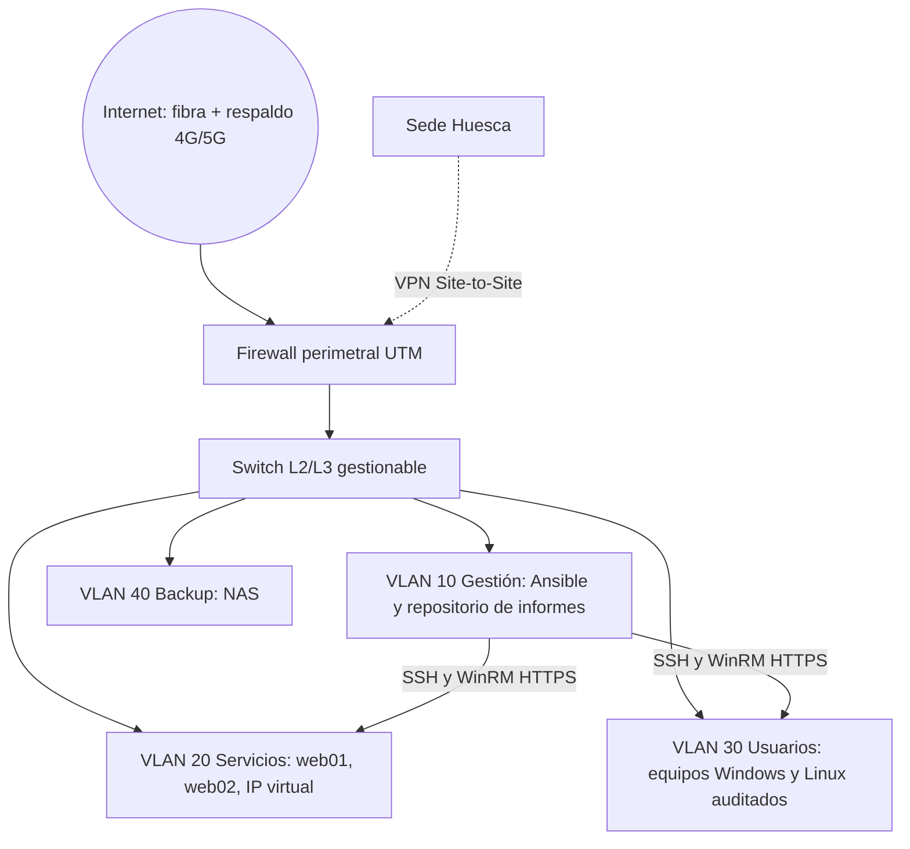

# Anteproyecto TFG ISA: Despliegue y detección de vulnerabilidades

**Ciclo:** Administración de Sistemas Informáticos en Red (ASIR/ISA)
**Módulo:** Proyecto de Administración de Sistemas Informáticos en Red
**Autores:** Andrés Ruslan Abadías Otal (`@nisamov`) y Vladyslav Ostroushko (`@vuladisulavu-dot`)
**Centro:** IES Sierra de Guara

## Índice

- [1. Definición de la idea de proyecto y justificación](#1-definición-de-la-idea-de-proyecto-y-justificación)
- [2. Análisis del sector productivo y entorno empresarial](#2-análisis-del-sector-productivo-y-entorno-empresarial)
- [3. Estudio de viabilidad técnica y arquitectura del sistema](#3-estudio-de-viabilidad-técnica-y-arquitectura-del-sistema)
- [4. Estimación de recursos y presupuesto económico inicial](#4-estimación-de-recursos-y-presupuesto-económico-inicial)
- [5. Guion de trabajo y calidad del diseño](#5-guion-de-trabajo-y-calidad-del-diseño)

## 1. Definición de la idea de proyecto y justificación

### 1.1. Justificación y contexto

Las pymes suelen tener un parque informático heterogéneo (servidores Linux, equipos Windows de usuario) que crece sin control de configuración. Nadie sabe con precisión qué puertos están abiertos, qué paquetes están desactualizados, qué ficheros tienen permisos excesivos o si SSH está bien configurado. Las auditorías de seguridad externas son caras y puntuales, de modo que la empresa trabaja meses con vulnerabilidades que nadie ha medido.

La carencia tecnológica concreta del cliente es doble:

- No dispone de un inventario ni de una auditoría de seguridad periódica y automatizada de sus equipos Linux y Windows.
- Su servicio web corporativo está en un único servidor sin redundancia, sin protección frente a fuerza bruta y con el certificado TLS renovado a mano.

El proyecto propone una plataforma que audita de forma centralizada y repetible todos los equipos, genera informes por equipo y propone (sin aplicar automáticamente) las correcciones, y que además despliega un servicio web con alta disponibilidad y bastionado básico.

### 1.2. Objetivos del proyecto

**Objetivo general:** diseñar e implantar una plataforma de auditoría automatizada de seguridad para equipos Linux y Windows, centralizada en un servidor principal con Ansible y Lynis, junto con un servicio web de alta disponibilidad bastionado.

**Objetivos específicos (medibles):**

- Auditar el 100 % de los equipos inventariados (servidores Linux y clientes Windows) en cada ejecución programada.
- Generar por cada equipo un paquete `equipoIP.tar.gz` con el informe completo, el resumen y un script de remediación propuesto.
- Completar un ciclo de auditoría de 40 equipos en un máximo de 30 minutos.
- Detectar, en Linux, posibles vías de escalada de privilegios (binarios SUID/SGID, `sudoers` laxos, ficheros con escritura global), puertos abiertos y puertos abiertos sin uso, y permisos excesivos en archivos y directorios críticos.
- Generar una propuesta de configuración SSH recomendada para cada servidor y comparar la actual con ella.
- Desplegar un servicio web con dos nodos y una IP virtual, con conmutación ante fallo en 5 segundos o menos.
- Instalar y configurar `fail2ban` (baneo tras 5 intentos fallidos) y `certbot` con renovación automática del certificado.
- Subir el índice de hardening de Lynis de los servidores Linux en al menos 15 puntos respecto a la medición inicial, hasta un mínimo de 75.

### 1.3. Alcance y delimitación

**Incluye (SÍ se va a instalar y configurar):**

- Servidor de gestión con Ansible y repositorio central de informes.
- Despliegue de Lynis en servidores Linux y de una herramienta de auditoría de hardening en clientes Windows, ambos gestionados con Ansible.
- Recolección centralizada de resultados en `equipoIP.tar.gz`.
- Clúster web de dos nodos (HAProxy + keepalived), `fail2ban` y `certbot`.
- Virtualización, red segmentada (VLAN), firewall perimetral y copias de seguridad de la plataforma.

**Queda explícitamente fuera:**

- Remediación automática y sin supervisión de las vulnerabilidades (el script `autorun.sh` solo se ejecuta tras aprobación del administrador).
- Pruebas de intrusión ofensivas (pentesting) y análisis de aplicaciones web a nivel de código.
- Servicios de correo, ERP o directorio activo del cliente.
- Equipos macOS, móviles y dispositivos IoT.
- Un SIEM completo con correlación de eventos en tiempo real.

## 2. Análisis del sector productivo y entorno empresarial

### 2.1. Caracterización de la empresa/entidad cliente

**Ficha de identificación básica**

- **Nombre de la empresa:** Suministros Industriales Gállego S.L. (ficticia).
- **Sector de actividad:** distribución de material industrial y ferretería profesional.
- **Tamaño y tipo:** pequeña empresa (38 empleados, facturación inferior a 10 M€).
- **Ubicación geográfica:** sede principal en Zaragoza (polígono industrial) y sede secundaria en Huesca (Polígono Monzú); 6 comerciales en movilidad.

**Organigrama y perfil de los usuarios**

- **Dirección / Gerencia:** 3 usuarios, necesitan movilidad, máxima seguridad y acceso a información estratégica.
- **Administración y gestión:** 9 usuarios con ERP, contabilidad y nóminas; manejan datos personales y financieros (RGPD).
- **Almacén / Operaciones:** 17 usuarios con terminales de radiofrecuencia y escáneres; necesitan sistemas sencillos y red estable.
- **Comerciales / teletrabajo:** 9 usuarios externos con portátiles y móviles.

**Mapa funcional del negocio**

El comercial toma el pedido en la aplicación web corporativa (servicio alojado en el clúster web) → el pedido llega al ERP del servidor central → el almacén recibe la orden de preparación en su terminal → se genera la factura y la etiqueta de envío. Si la web o el servidor central caen, la empresa no factura ni expide.

**Traducción de la estructura en necesidades técnicas**

| Departamento | Herramienta / software usado | Necesidad informática real |
|---|---|---|
| Dirección / movilidad | Portátiles Windows, acceso a la web corporativa | Equipos auditados y bastionados, cifrado de disco, acceso seguro con certificado TLS válido |
| Administración | ERP, contabilidad, correo, carpetas compartidas | Auditoría periódica de configuración de los equipos Windows, detección de parches pendientes y copia de seguridad diaria |
| Almacén / operaciones | Terminales, impresoras de etiquetas, servidores Linux de aplicación | Red aislada por VLAN, servidores Linux sin servicios innecesarios ni puertos abiertos sin uso |
| Comerciales | Portátiles, aplicación web de pedidos | Servicio web siempre disponible (alta disponibilidad) y protegido frente a fuerza bruta |
| Sede de Huesca | Acceso a web y ERP central | Conectividad estable con la sede principal y equipos incluidos en el ciclo de auditoría |
| Sistemas (interno) | Servidores Linux y Windows | Informes centralizados por equipo, sin tener que entrar uno a uno |

### 2.2. Oportunidades de negocio y viabilidad

- **Retorno de inversión por evitación de pérdidas:** se supone, para el cliente ficticio, que una jornada de parada cuesta 6.500 € (facturación no cursada, personal improductivo). Un incidente de ransomware con 3 días de parada supone unos 19.500 €, más la recuperación y una posible sanción de la AEPD. La inversión inicial (16.420 € sin IVA) se amortiza evitando un único incidente de este tipo.
- **Eliminación de deuda técnica:** la plataforma identifica paquetes sin parchear, servicios obsoletos y configuraciones débiles antes de que sean explotados. Sustituye la revisión manual y ocasional por una medición automática con histórico.
- **Eficiencia y productividad:** una auditoría manual de un equipo lleva unos 45 minutos; automatizada, el tiempo humano baja a unos 5 minutos por equipo para revisar el informe. Con 40 equipos y revisión trimestral, el ahorro es de unas 100 horas/hombre al año. A ello se suma que el clúster web evita paradas del servicio de pedidos.

### 2.3. Marco legal y normativa

- **RGPD y LOPDGDD:** los informes pueden contener nombres de usuario, rutas y direcciones IP. Se almacenan cifrados, con acceso restringido y con la finalidad de seguridad documentada. La auditoría no accede al contenido de los ficheros de los usuarios.
- **Esquema Nacional de Seguridad (ENS):** no obligatorio para una empresa privada, pero se toma como referencia de buenas prácticas (medidas de configuración de seguridad y registro de actividad).
- **LSSI-CE:** aplicable al servicio web corporativo (información del titular, aviso legal y cookies).
- **Normativa laboral:** el análisis de los equipos de trabajo se informa a la plantilla y respeta la LO 3/2018 (arts. 87 a 91, derecho a la intimidad en el uso de dispositivos digitales).
- **Código Penal (art. 197 bis):** el acceso a sistemas sin autorización es delito, por lo que se firma una autorización escrita del cliente que delimita los equipos auditables.
- **PRL:** aplicación del RD 488/1997 (pantallas de visualización) y de las medidas de seguridad eléctrica y de trabajo en altura durante el montaje de rack y cableado.

### 2.4. Financiación y subvenciones

- **Kit Digital (Red.es, Next Generation EU):** incluye una categoría de ciberseguridad. Requiere comprobar si hay convocatoria abierta para el segmento de la empresa (10 a 49 empleados) y que el servicio se contrate a un agente digitalizador adherido. **[PENDIENTE: verificar convocatoria vigente e importe máximo.]**
- **Ayudas autonómicas del Gobierno de Aragón** (modernización y digitalización de pymes, a través de Aragón Empresa o IAF). **[PENDIENTE: verificar convocatoria vigente, porcentaje subvencionable y plazo de solicitud.]**
- **Financiación ICO:** líneas de inversión para pymes, descritas en el punto 4.4 como alternativa.

La viabilidad de la solicitud depende de que el gasto sea elegible (consultoría e implantación sí; el hardware puede estar limitado) y de que se solicite antes de contratar.

## 3. Estudio de viabilidad técnica y arquitectura del sistema

### 3.1. Recopilación de información

Solo se comparan las opciones reales que se han valorado para cada decisión.

**Herramienta de auditoría en Linux**

| Criterio | Lynis | OpenSCAP | Wazuh |
|---|---|---|---|
| Licencia | Open Source (versión Community) | Open Source | Open Source |
| Despliegue | Un único script, sin dependencias ni agente | Requiere paquetes y perfiles SCAP | Agente + servidor + indexador |
| Salida | `lynis-report.dat` y log verbose fácil de procesar | XML/HTML | Panel web |
| Consumo de recursos | Muy bajo, ejecución bajo demanda | Medio | Alto (servicio permanente) |
| Adecuación al proyecto | Alta: auditoría puntual y sencilla de automatizar | Media | Excesiva para el alcance (SIEM) |

Se selecciona Lynis por su simplicidad y por generar informes que se pueden recolectar por equipo.

**Herramienta de auditoría en Windows**

| Criterio | HardeningKitty | CIS-CAT Lite | Microsoft Security Compliance Toolkit |
|---|---|---|---|
| Licencia | Open Source (PowerShell) | Gratuita con registro, limitada | Gratuita |
| Automatización con Ansible | Sencilla (script PowerShell vía WinRM) | Más compleja | Más orientada a GPO |
| Referencia | CIS, Microsoft, BSI | CIS Benchmarks | Líneas base de Microsoft |
| Salida | CSV/log | HTML/XML | Informes de GPO |

Opción provisional: HardeningKitty por su integración sencilla con Ansible y su salida en CSV. **[PENDIENTE: confirmar tras probarlo en maqueta con Windows 10 y 11.]**

**Orquestación**

| Criterio | Ansible | Puppet / Salt | Scripts propios |
|---|---|---|---|
| Agente en los equipos | No (SSH y WinRM) | Sí | No |
| Curva de aprendizaje | Baja | Media/alta | Baja |
| Soporte Windows | Sí, mediante WinRM | Sí | Limitado |
| Mantenibilidad | Alta (playbooks idempotentes) | Alta | Baja |

**Plataforma de virtualización**

| Criterio | Proxmox VE | VMware ESXi | Hyper-V |
|---|---|---|---|
| Coste | Gratuito; suscripción opcional de soporte | De pago, con cambios de licenciamiento tras la compra de VMware por Broadcom | Incluido con Windows Server (licencia) |
| Alta disponibilidad | Clúster con HA integrado | Requiere vCenter y licencias | Failover Clustering |
| Contenedores | LXC integrado | No | No |
| Requisitos de hardware | Moderados | Lista de compatibilidad estricta | Moderados |

**Balanceo y alta disponibilidad del servicio web**

| Criterio | HAProxy + keepalived | Nginx + keepalived | Balanceador cloud |
|---|---|---|---|
| Coste | Gratuito | Gratuito | Cuota mensual |
| Conmutación | IP virtual (VRRP) en segundos | Igual | Gestionada por el proveedor |
| Control | Total | Total | Limitado |

### 3.2. Viabilidad técnica

**Hardware y electrónica de red**

- **Decisión:** 2 servidores Dell PowerEdge de 1 socket (tipo R250/R350) para el clúster Proxmox, 1 NAS de 2 bahías para copias, 1 switch gestionable L2/L3 con VLAN, 1 firewall perimetral con UTM y 1 SAI.
- **Justificación:** 32 GB de RAM ECC por nodo, doble tarjeta de red, 2 discos en RAID 1 (sistema) y 2 SSD empresariales en RAID 1 (máquinas virtuales). El RAID 1 se elige por no ser necesario el rendimiento de RAID 10 en esta carga.

**Software propietario vs. Open Source**

- **Decisión:** toda la plataforma es Open Source (Proxmox VE, Debian, Ansible, Lynis, HAProxy, keepalived, fail2ban, certbot) y las únicas partes de pago son la suscripción del firewall y la del soporte de Proxmox.
- **Justificación:** no se compran licencias de sistema operativo porque los clientes Windows ya están licenciados y los servidores son Linux. La inversión de licencias se dedica a soporte y firmas de seguridad, que son las partes críticas.

**Dimensionamiento y escalabilidad**

La carga inicial son 40 equipos auditados, 2 máquinas virtuales web, 1 de gestión y 1 de repositorio. Con 32 GB de RAM por nodo, el consumo inicial queda por debajo del 50 %, lo que permite un crecimiento del 30 % de equipos auditados y nuevas máquinas virtuales durante 3 a 5 años sin cambiar el hardware.

**Integración y conectividad**

- Enlaces de 1 Gbps entre servidores y switch (suficientes para el tráfico de auditoría, que son ficheros de texto de pocos MB).
- Fibra simétrica dedicada con respaldo 4G/5G para la sede de Huesca y para la salida a Internet del servicio web.
- Acceso de gestión solo desde la VLAN de gestión, mediante SSH con clave y WinRM sobre HTTPS.

### 3.3. Especificación de la arquitectura

**Topología de red**

**Arquitectura de servidores**

Virtualización con clúster Proxmox de 2 nodos y dispositivo de quórum externo (qdevice). Máquinas virtuales:

- `ansible-ctrl`: nodo de control, ejecuta los playbooks y recibe los `equipoIP.tar.gz`.
- `reports`: almacén de informes con acceso restringido y retención configurable.
- `web01` y `web02`: aplicación web con HAProxy y keepalived (IP virtual compartida), `fail2ban` y `certbot`.

**Direccionamiento IP y segmentación**

| VLAN | Nombre | Red | Uso |
|---|---|---|---|
| 10 | Gestión | 10.10.10.0/24 | Ansible, repositorio de informes, administración de Proxmox |
| 20 | Servicios | 10.10.20.0/24 | web01 (.11), web02 (.12), IP virtual (.10) |
| 30 | Usuarios | 10.10.30.0/24 | Equipos Windows y Linux de usuario |
| 40 | Backup | 10.10.40.0/24 | NAS de copias |

**Flujo de auditoría**

- Ansible se conecta a cada equipo (SSH en Linux, WinRM en Windows) con una cuenta de servicio de privilegios mínimos.
- En Linux ejecuta Lynis con `--verbose`, más tareas propias de escalada de privilegios (SUID/SGID, `sudoers`, ficheros world-writable), puertos abiertos frente a servicios en uso, permisos de directorios críticos y comparación de `sshd_config` con la configuración recomendada.
- En Windows ejecuta la herramienta de hardening y recoge la salida.
- Cada equipo genera `equipoIP.tar.gz` y se envía al servidor principal.

Contenido del paquete por equipo:

- `full_log.log`: log completo de la herramienta de auditoría en modo verbose.
- `resumen.json`: índice de hardening, advertencias y sugerencias, puertos abiertos y permisos críticos.
- `ssh_recomendado.conf`: configuración SSH propuesta (solo Linux).
- `autorun.sh` (Linux) o `autorun.ps1` (Windows): acciones de actualización de paquetes vulnerables y correcciones propuestas. **No se ejecutan automáticamente**: requieren revisión y aprobación del administrador.
- `SHA256SUMS`: huellas del contenido para garantizar la integridad.

**Políticas de almacenamiento y copias de seguridad**

- Regla 3-2-1 para el repositorio de informes y las máquinas virtuales: 3 copias, en 2 soportes distintos, 1 externalizada en la nube cifrada.
- Copia diaria de las máquinas virtuales al NAS (ventana de 01:00 a 05:00).
- Retención de informes de 12 meses para poder comparar la evolución del índice de hardening.

## 4. Estimación de recursos y presupuesto económico inicial

> **Aviso de verificación:** los precios de este borrador son estimaciones de orden de magnitud. Antes de entregar, deben sustituirse por el precio real sin IVA de un distribuidor IT (Senetic, Dell, HPE, Bechtle) con su enlace de referencia, tal y como exige la guía.

### 4.1. Recurso material y licenciamiento

**Hardware y electrónica de red** (precios sin IVA, a verificar)

| Elemento | Uds. | Precio unitario | Subtotal |
|---|---|---|---|
| Servidor Dell PowerEdge 1 socket, 32 GB ECC, doble NIC, discos Enterprise | 2 | 2.300 € | 4.600 € |
| Switch gestionable L2/L3 con VLAN | 1 | 480 € | 480 € |
| Firewall perimetral con UTM | 1 | 650 € | 650 € |
| NAS 2 bahías | 1 | 750 € | 750 € |
| Discos Enterprise para el NAS | 2 | 260 € | 520 € |
| SAI | 1 | 520 € | 520 € |
| Armario rack 9U | 1 | 300 € | 300 € |
| Cableado estructurado y latiguillos | 1 | 280 € | 280 € |
| **Total hardware** | | | **8.100 €** |

**Licenciamiento de software**

| Elemento | Tipo | Coste |
|---|---|---|
| Proxmox VE, Debian, Ansible, Lynis, HAProxy, keepalived, fail2ban, certbot | Open Source | 0 € |
| Herramienta de auditoría en Windows | Open Source | 0 € |
| Suscripción de soporte Proxmox (2 sockets) | Anual | 230 €/año |
| Licencia UTM del firewall (firmas IPS, antivirus, filtrado web) | Anual | 250 €/año |
| **Licencias perpetuas** | | **0 €** |

**Servicios cloud e infraestructura externa**

| Elemento | Coste |
|---|---|
| Copia externalizada cifrada (almacenamiento cloud) | 360 €/año |
| Dominio | 15 €/año |
| Certificados TLS | 0 € (Let's Encrypt mediante `certbot`) |

### 4.2. Recursos humanos

| Tarea / fase | Perfil técnico | Horas | Coste/hora | Subtotal |
|---|---|---|---|---|
| Análisis y toma de requisitos | Consultor senior | 12 h | 75 € | 900 € |
| Diseño y configuración en maqueta/taller | Adm. de sistemas | 40 h | 50 € | 2.000 € |
| Montaje físico en rack y cableado | Técnico nivel 1 | 12 h | 35 € | 420 € |
| Desarrollo y prueba de playbooks, scripts y paquetes de auditoría | Adm. de sistemas | 45 h | 50 € | 2.250 € |
| Despliegue de servicios (clúster web, fail2ban, certbot) y migración | Adm. de sistemas | 25 h | 50 € | 1.250 € |
| Pruebas de estrés y ajustes (QA) | Adm. de sistemas | 15 h | 50 € | 750 € |
| Formación al cliente y documentación | Consultor senior | 10 h | 75 € | 750 € |
| **Total mano de obra** | | **159 h** | | **8.320 €** |

### 4.3. Presupuesto económico de ejecución

**A. Inversión inicial (CapEx)**

- Hardware y electrónica de red (4.1): 8.100,00 €
- Licencias perpetuas (4.1): 0,00 €
- Mano de obra e implantación (4.2): 8.320,00 €
- **Subtotal CapEx (base imponible): 16.420,00 €**

**B. Gasto anual recurrente (OpEx, primer año)**

- Suscripción de soporte Proxmox: 230,00 €/año
- Licencia UTM del firewall: 250,00 €/año
- Copia externalizada cifrada: 360,00 €/año
- Dominio: 15,00 €/año
- **Subtotal OpEx anual (base imponible): 855,00 €**

**C. Totales e impuestos (IVA 21 %)**

| Concepto | Base imponible | IVA (21 %) | Total |
|---|---|---|---|
| CapEx | 16.420,00 € | 3.448,20 € | **19.868,20 €** |
| OpEx anual | 855,00 € | 179,55 € | **1.034,55 €** |

### 4.4. Necesidades de financiación

Para no comprometer la tesorería de la empresa, se propone financiar el hardware (8.100 € sin IVA) mediante un contrato de renting tecnológico a 36 meses, con una cuota estimada de unos 270 €/mes más IVA **[PENDIENTE: sustituir por oferta real de la financiera]**. El gasto pasa a ser íntegramente deducible y el hardware se renueva al terminar el contrato. La fase de consultoría e implantación (8.320 €) se pretende cubrir con fondos propios y una subvención de digitalización **[PENDIENTE: importe y convocatoria a confirmar según el punto 2.4]**. Como alternativa, se valora un préstamo ICO de inversión a 5 años si no se obtiene la ayuda.

## 5. Guion de trabajo y calidad del diseño

### 5.1. Guion metodológico

El proyecto se ejecutará en un plazo estimado de 6 semanas, dividido en 5 fases principales. A continuación se presenta el cronograma preliminar mediante una tabla de hitos macro:

| Fase | Contenido | Duración estimada | Hito de salida |
|---|---|---|---|
| Fase 1: Aprovisionamiento y compras | Firma del presupuesto, pedido y recepción de servidores y electrónica | Semanas 1 y 2 | Material en las instalaciones |
| Fase 2: Configuración en taller / maqueta | Proxmox, máquinas virtuales, Ansible, Lynis y herramienta de Windows, desarrollo de playbooks | Semanas 3 y 4 | Plataforma de auditoría funcionando en maqueta |
| Fase 3: Despliegue físico y migración | Instalación en rack del cliente, parcheo, clúster web, `fail2ban`, `certbot` | Semana 5 | Servicios en producción |
| Fase 4: Pruebas y cierre | Primera auditoría completa, pruebas de conmutación, medición de indicadores, formación | Semana 6 | Informe de indicadores firmado |

### 5.2. Indicadores de calidad

Para garantizar el éxito de la implantación en las fases finales, se establecen los siguientes indicadores o parámetros técnicos que se medirán antes del pase a producción para certificar que el diseño propuesto es robusto, escalable y seguro:

**Criterios de robustez**

| Indicador | Valor objetivo | Cómo se mide |
|---|---|---|
| Disponibilidad del servicio web (uptime) | 99,9 % (máximo 8,8 h de caída al año) | Monitorización del servicio durante la fase de pruebas |
| Tiempo de conmutación de la IP virtual ante fallo de un nodo | ≤ 5 s | Apagado forzado de un nodo con ping continuo |
| RTO (restauración de una máquina virtual desde copia) | ≤ 2 h | Simulacro de restauración |
| Ciclo de auditoría de 40 equipos | ≤ 30 min | Tiempo de ejecución del playbook |
| Equipos auditados con éxito | 100 % del inventario | Número de `equipoIP.tar.gz` recibidos frente al inventario |

**Criterios de escalabilidad**

| Indicador | Valor objetivo | Cómo se mide |
|---|---|---|
| Uso de RAM de los servidores | ≤ 50 % en picos | Métricas de Proxmox |
| Uso de CPU de los servidores | ≤ 40 % en picos | Métricas de Proxmox |
| Bocas libres en el switch | ≥ 30 % | Inventario del rack |
| Bahías libres en el NAS | ≥ 1 | Inventario del rack |

**Criterios de seguridad**

| Indicador | Valor objetivo | Cómo se mide |
|---|---|---|
| Índice de hardening de Lynis en servidores Linux | ≥ 75 y mejora mínima de 15 puntos sobre la medición inicial | Informes de Lynis antes y después |
| Regla de backup 3-2-1 | 3 copias, 2 soportes, 1 externa | Registros (logs) de copia |
| Puertos expuestos a Internet | Solo 80 y 443; ningún puerto RDP ni SSH | Escaneo de puertos externo |
| Calificación TLS del servicio web | A o superior | Prueba con SSL Labs |
| Baneo de fuerza bruta | Bloqueo tras 5 intentos fallidos | Prueba controlada con `fail2ban` |
| Integridad de los paquetes de auditoría | 100 % con huella verificada | Comprobación de `SHA256SUMS` |
